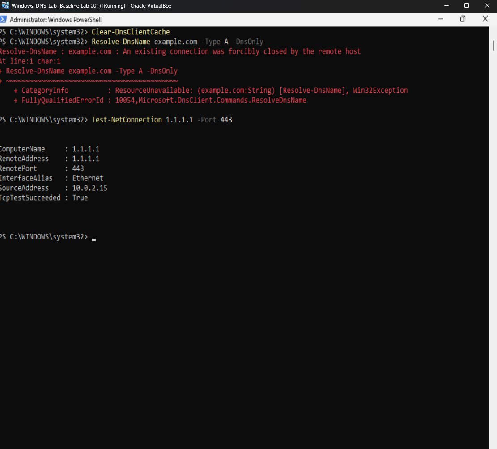

# Lab 001 · Investigate a Windows DNS fault

**Status:** Completed · 26 November 2026  
**Environment:** Windows 11 Enterprise Evaluation VM, Oracle VirtualBox, NAT networking  
**Tools:** Windows PowerShell, nslookup, Ethernet adapter settings, Microsoft Edge InPrivate

I reproduced a DNS failure in a Windows VM and verified that it could still reach an external IP address on TCP port 443. During the investigation, I found that changing only the IPv4 DNS setting left a working IPv6 resolver available. I restored the original settings and confirmed the website opened again.

## Ticket

**Simulated user report:** “The website won’t load. Has the internet connection dropped?”

**Expected behaviour:** The user can open `https://example.com` in Edge.

**Question to investigate:** Can the VM still connect to an external IP address when Windows cannot look up the website’s name?

## Lab setup

I used the VM’s Ethernet adapter and recorded its DNS settings before introducing the fault. I took a VirtualBox snapshot named `Baseline Lab 001` so I had a working state to return to.

I used two checks throughout the exercise:

- `Resolve-DnsName example.com -Type A -DnsOnly` asks DNS for the website’s IPv4 address.
- `Test-NetConnection 1.1.1.1 -Port 443` tests a TCP connection to a numeric address, so this check can succeed even when name resolution fails.

## Investigation

| Step | What I checked | What I observed and why it mattered |
|---|---|---|
| 1. Change IPv4 DNS | I set the preferred IPv4 DNS server to `127.0.0.1`, cleared the DNS cache and repeated both checks. | `example.com` still resolved and TCP port 443 was reachable. The intended fault had not yet been reproduced, so I checked which other DNS servers were configured. |
| 2. Inspect the adapter | I ran `Get-DnsClientServerAddress -InterfaceAlias "Ethernet"` and queried `127.0.0.1` directly with `nslookup`. | Ethernet listed both an IPv4 and an IPv6 DNS server. The direct IPv4 query returned “No response from server.” [View IPv4 evidence](evidence/01-ipv4-loopback.png) |
| 3. Test the IPv6 resolver | I sent the same A-record query directly to `fd17:625c:f037:2::3`. | It returned `172.66.147.243` and `104.20.23.154`. This confirmed the VM still had a resolver capable of answering the query. [View IPv6 evidence](evidence/02-ipv6-resolver.png) |
| 4. Reproduce the full fault | I also set the preferred IPv6 DNS server to `::1`, cleared the cache and repeated the lookup and TCP test. | The DNS lookup failed with error `10054`. The TCP connection to `1.1.1.1:443` still succeeded. This narrowed the fault to name resolution. |

## Resolution and verification

I restored the Ethernet adapter’s original IPv4 and IPv6 DNS settings, then cleared the Windows DNS cache and repeated the same checks.

| Verification | Observed result |
|---|---|
| Ethernet DNS configuration | IPv4 DNS showed `192.168.1.254` and IPv6 DNS showed `fd17:625c:f037:2::3`. |
| Fresh DNS lookup | `example.com` returned A records `104.20.23.154` and `172.66.147.243`. |
| Direct TCP connection | `Test-NetConnection 1.1.1.1 -Port 443` returned `TcpTestSucceeded : True`. |
| Original user task | `https://example.com` opened in a fresh Edge InPrivate window. |

[View the PowerShell retest](evidence/04-dns-restored.png) · [View the browser retest](evidence/05-browser-restored.png)

## Ticket closure

I restored the VM’s DNS settings and confirmed that the website opened in Edge. During the fault, the VM could still reach an external IP address. The failed step was looking up the website’s name.

## What I learned

An IPv6 DNS server can answer a request for an IPv4 address. When the first change didn’t produce the expected failure, testing each configured resolver directly helped me explain what I was seeing.
